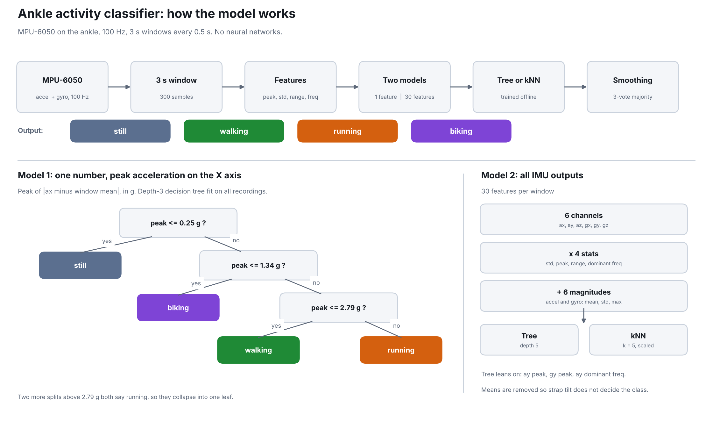

# Ankle activity wearable

An Arduino UNO Q with an MPU-6050 on the ankle that tells standing still, walking, running and biking apart. No neural networks. Two models, each as a decision tree and as nearest-neighbor:

- **Model 1:** one feature, the peak acceleration on the X axis.
- **Model 2:** 30 features from all six IMU channels.



## Results

| Model | Leave-one-recording-out | New recordings |
|---|---|---|
| Model 1 (peak X only) + decision tree | 80.0% | 100% |
| Model 1 + kNN | 77.7% | 94.9% |
| Model 2 (30 features) + decision tree | 91.4% | 100% |
| Model 2 + kNN | 91.0% | 97.0% |

All data is one person, one ankle, one afternoon. Biking was done sitting in a chair.

## Layout

- `board/sketch/sketch.ino`: MCU side. Reads the IMU at 100 Hz and sends batches over the Bridge.
- `board/python/`: Linux side (App Lab app). `main.py` records CSVs or runs live prediction and publishes over MQTT. `features.py` builds the features, `tinyml.py` runs the trees and kNN with numpy only, and `models/models.json` holds the trained models.
- `laptop/train.py`: trains and compares the four models (leave-one-recording-out) and makes the figures.
- `laptop/evaluate.py`: scores the models on the held-out `*_t*.csv` recordings.
- `laptop/export_models.py`: writes `models.json` and checks it matches scikit-learn.
- `laptop/dashboard.py`: live dashboard (`py dashboard.py`, then open http://localhost:8765).
- `data/`: the recordings. `*_s1*.csv` are training, `*_t*.csv` are the test set. Columns are `t_ms,ax_g,ay_g,az_g,gx_dps,gy_dps,gz_dps`, 100 Hz.

## How to run

1. Wire the MPU-6050 to the UNO Q (3.3 V, GND, SDA, SCL; I2C address 0x68).
2. In Arduino App Lab, make an app and copy in `board/sketch/` and `board/python/`.
3. Train on the laptop (needs numpy, scikit-learn, matplotlib, joblib):
   ```
   cd laptop
   py train.py --data ../data --out models --kmeans
   py evaluate.py --data ../data --models models
   py export_models.py
   ```
   Then copy `models/models.json` into `board/python/models/` on the board.
4. Start the app on the board. Run `py laptop/dashboard.py` (needs paho-mqtt). It asks the board for live predictions.

The board and dashboard talk over the public broker `broker.hivemq.com` on the topic prefix `ME193/Kabir/ankle`. Change `PREFIX` in `main.py` and `dashboard.py` if you want your own topic.
